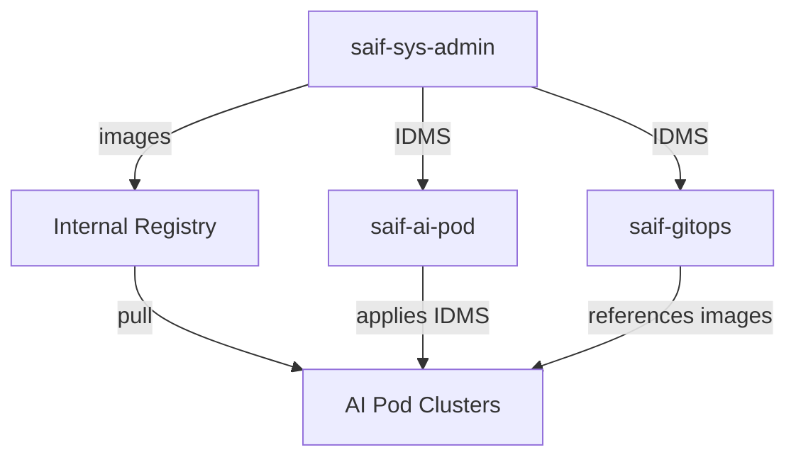

# Architecture: Infrastructure Services

## Overview

saif-sys-admin provides foundational infrastructure services for the SAIF Platform. It manages the runner VM (single point of failure), container image mirroring for air-gapped deployments, and cluster user provisioning.

## System Diagram

```
                                    INTERNET
                                        │
                                        │ (registry.redhat.io, quay.io, ghcr.io)
                                        │
┌───────────────────────────────────────┼───────────────────────────────────────┐
│                           LAB NETWORK                                          │
│                                       │                                        │
│                                       ▼                                        │
│  ┌─────────────────────────────────────────────────────────────────────────┐  │
│  │                    RUNNER VM (10.0.0.10)                            │  │
│  │                         SINGLE POINT OF FAILURE                          │  │
│  │  ┌─────────────┐  ┌─────────────┐  ┌─────────────┐  ┌─────────────┐    │  │
│  │  │  Registry   │  │  Web Server │  │   Runners   │  │   Gitea     │    │  │
│  │  │  :5000      │  │  :80        │  │  (DinD x3)  │  │  :3000      │    │  │
│  │  └──────┬──────┘  └──────┬──────┘  └──────┬──────┘  └─────────────┘    │  │
│  │         │                │                │                             │  │
│  │         │                │                │     ┌─────────────┐         │  │
│  │         │                │                │     │  TF State   │         │  │
│  │         │                │                │     │  :8081      │         │  │
│  │         │                │                │     └─────────────┘         │  │
│  └─────────┼────────────────┼────────────────┼─────────────────────────────┘  │
│            │                │                │                                 │
│            ▼                ▼                ▼                                 │
│  ┌─────────────────────────────────────────────────────────────────────────┐  │
│  │                      AI POD CLUSTERS (1-4)                              │  │
│  │                                                                          │  │
│  │   Pull images        Boot via vMedia      Execute workflows             │  │
│  │   from registry      ISO from nginx       triggered by runners          │  │
│  │                                                                          │  │
│  └─────────────────────────────────────────────────────────────────────────┘  │
│                                                                                │
└────────────────────────────────────────────────────────────────────────────────┘
```

## Components

### Runner VM Services

| Service | Port | Purpose | Impact if Down |
|---------|------|---------|----------------|
| Container Registry | 5000 | Image storage for air-gapped clusters | ALL deployments blocked |
| Web Server (nginx) | 80 | ISO hosting for Intersight vMedia | Cluster boot blocked |
| Terraform State | 8081 | UCS profile state storage | UCS changes blocked |
| GitHub Runners | N/A | Execute CI/CD workflows | ALL workflows blocked |
| Gitea | 3000 | Internal git server (backup) | Minimal impact |

### Workflows

| Workflow | Purpose | Trigger |
|----------|---------|---------|
| `sync-images.yaml` | Mirror container images from public registries | Manual or scheduled |
| `manage-cluster-users.yaml` | Provision HTPasswd users and SSH access | Manual |
| `configure-runner-vm.yaml` | Configure runner VM services via Ansible | Manual |
| `sync-nim-models.yaml` | Sync NVIDIA NIM models to local storage | Manual |
| `sync-nvidia-llm.yaml` | Sync NVIDIA LLM containers | Manual |

## Data Flow

### Image Mirroring Flow

```
┌──────────────────┐    ┌──────────────────┐    ┌──────────────────┐
│  Public Registry │    │   sync-images    │    │ Internal Registry│
│                  │───▶│    workflow      │───▶│                  │
│ registry.redhat.io│    │                  │    │ registry.        │
│ quay.io          │    │ (oc-mirror)      │    │ example.com:5000 │
│ ghcr.io          │    │                  │    │                  │
└──────────────────┘    └────────┬─────────┘    └──────────────────┘
                                 │
                                 ▼
                        ┌──────────────────┐
                        │  IDMS Manifests  │
                        │                  │
                        │ mirror/idms/*.yaml│
                        └────────┬─────────┘
                                 │
              ┌──────────────────┼──────────────────┐
              ▼                  ▼                  ▼
     ┌─────────────┐    ┌─────────────┐    ┌─────────────┐
     │  ai-pod-1   │    │  ai-pod-2   │    │  ai-pod-N   │
     │   IDMS      │    │   IDMS      │    │   IDMS      │
     └─────────────┘    └─────────────┘    └─────────────┘
```

### User Provisioning Flow

```
┌──────────────────┐    ┌──────────────────┐    ┌──────────────────┐
│  GitHub Action   │    │  manage-cluster  │    │   OpenShift      │
│  Trigger         │───▶│  -users workflow │───▶│   HTPasswd       │
│                  │    │                  │    │   Secret         │
└──────────────────┘    └────────┬─────────┘    └──────────────────┘
                                 │
                                 ├───▶ ClusterRoleBinding
                                 │
                                 ├───▶ Jump Host User (SSH)
                                 │
                                 └───▶ WebEx Notification
```

## Integration Points

### Consumes

| From | What | Purpose |
|------|------|---------|
| registry.redhat.io | Container images | OpenShift, operators |
| quay.io/isovalent | Cilium/Tetragon images | Network security |
| ghcr.io | Community images | Various tools |
| GitHub | Workflow triggers | CI/CD automation |
| Kubeconfig storage repo | Cluster credentials | User provisioning |

### Produces

| To | What | Purpose |
|----|------|---------|
| Internal Registry | Mirrored images | Air-gapped deployments |
| mirror/idms/ | IDMS manifests | Image redirection |
| AI Pod Clusters | Users, credentials | Access management |
| saif-ai-pod | ISO files (nginx) | Cluster installation |

### Critical Dependencies



## Directory Structure

```
saif-sys-admin/
├── .github/workflows/
│   ├── sync-images.yaml           # Main image mirroring
│   ├── manage-cluster-users.yaml  # User provisioning
│   ├── configure-runner-vm.yaml   # Ansible runner config
│   ├── sync-nim-models.yaml       # NIM model sync
│   └── sync-nvidia-llm.yaml       # NVIDIA LLM sync
├── ansible/
│   ├── playbooks/
│   │   └── configure-runner.yaml  # Main Ansible playbook
│   └── requirements.yml           # Ansible dependencies
├── mirror/
│   ├── redhat-operators.yaml      # Operator images list
│   ├── platform-images.yaml       # Platform images list
│   ├── other-images.yaml          # Community images list
│   ├── IMAGES_REFERENCE.yaml      # Full reference list
│   └── idms/                      # Generated IDMS manifests
├── environments/
│   └── example/hosts.ini          # Ansible inventory
└── README.md                      # Quick start
```

## Security Considerations

### Secrets Management

| Secret | Storage | Access |
|--------|---------|--------|
| REDHAT_PULL_SECRET | GitHub Secrets | sync-images workflow |
| KUBECONFIG_REPO_TOKEN | GitHub Secrets | All cluster-accessing workflows |
| WEBEX_BOT_TOKEN | GitHub Secrets | manage-cluster-users workflow |
| JUMP_HOST_SSH_KEY | GitHub Secrets | User SSH provisioning |

### Network Security

- Runner VM is accessible only from lab network
- Registry uses self-signed TLS certificate
- SSH access requires jump host traversal
- GitHub Actions use ephemeral tokens

## Failure Scenarios

| Failure | Impact | Recovery |
|---------|--------|----------|
| Runner VM down | ALL workflows blocked | Restore VM or rebuild |
| Registry down | No image pulls | Restart registry container |
| Web server down | No cluster boots | Restart nginx container |
| TF state down | No UCS changes | Restart terraform-backend |
| GitHub down | No workflow triggers | Wait for GitHub recovery |

## Related Documentation

- [saif-ai-pod IDMS Application](https://github.com/mahowlin/saif-ai-pod/blob/main/docs/mop/02-image-mirroring.md)
- [saif-gitops Platform IDMS](https://github.com/mahowlin/saif-gitops/blob/main/apps/platform-idms/)
- See your organization's runner VM configuration repository for the original Ansible source
