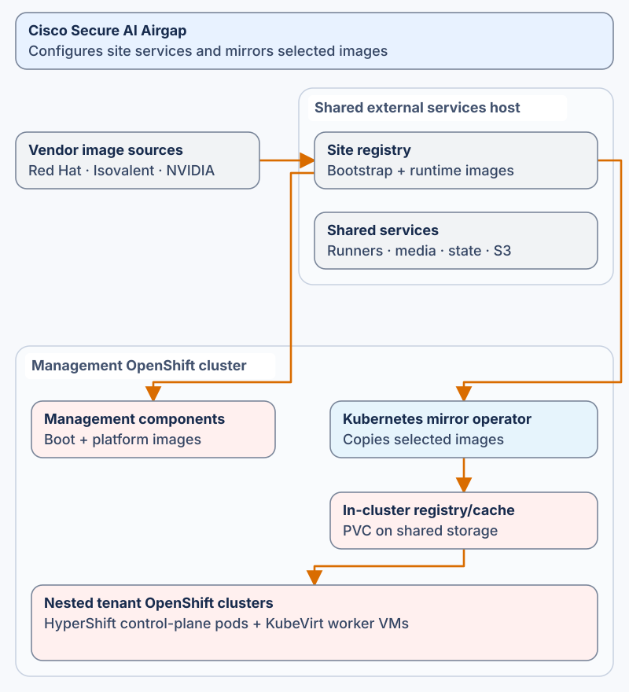

# Infrastructure services and image delivery

This repository owns the independently configured runner/service host, image
production and bounded maintenance adapters. Datacenter owns shared deployment
inputs; Compute owns installation; GitOps owns reconciliation. A standalone
recipient can use an existing trusted registry and boot infrastructure instead
of creating this repository's service VM.

## Service host

The selected environment's `group_vars.yml` and inventory own addresses, service
ports, storage paths and registration scope. The public example declares five
GitHub runners sharing the host Docker socket. They are not three isolated
Docker-in-Docker daemons. The service VM remains a single point of failure;
source automation does not provide service failover.

| Service | Role and consumers | Source owner |
|---|---|---|
| Registry | Mirrored release, operator and workload images for entitled consumers | registry variables and selected mirror recipes |
| nginx/WebDAV | Hosts installer media produced by Compute and optional model artifacts | webserver variables and approved private authentication |
| GitHub runners | Execute the selected repositories' workflows | runner scope, URL, count, image, socket and ownership variables |
| Terraform state backend | Stores and locks the execution repositories' state | tfstate variables and private backend authentication |
| RustFS S3 | Receives selected flow exports and supplies Timescape ingestion | declared endpoint, bucket, lifecycle/size settings and runtime identities |
| Gitea | Retained legacy cache; not the primary GitOps source | optional Gitea variables and private admin reference |

Runner replacement requires an independent executor and verified ownership.
The owning workflow passes private SSH/key, known-host and selected-service
references. Missing trust, credentials or Docker observation blocks the affected
operation. A template or synthetic local test is not a running-service claim.

## Image production and consumer policy

The main mirror workflow is manually dispatched; its schedule is disabled. Its
selected recipes define what is copied. Isovalent discovery, copy and verification
share `mirror/isovalent-selection.yaml`, including actual selected public
Timescape/Vector references. Retained rollback images may also be in the recipe;
inventory membership does not prove a current cluster uses an image.

The mirror workflow produces reviewed immutable policy bundles with source
hashes and declared scope. Compute and GitOps consume the appropriate bundles;
a historical `mirror/idms` directory alone does not establish current closure.
The existing-registry variant is valid when its own content, auth and trust are
qualified. Changing a version label never populates the destination registry.

Package contracts come from the exact reviewed Datacenter source revision.
Sanitized public package examples schema-validate locally, but require ordinary
source-main promotion before the publisher will accept provenance. Official
archives remain entitlement-controlled ephemeral inputs. No private historical
receipt attests sanitized public bytes.

## Installation and maintenance ownership

Compute creates and verifies installer media, then uploads it to the declared
web service. Airgap does not generate the OpenShift ISO. GitOps syncs reviewed
Applications from GitHub; Gitea is not an implicit source replacement.

Optional user maintenance changes only workflow-owned User subjects and marked
jump-host accounts. Shared User/Identity objects and unrelated bindings survive.
Optional model, endpoint and demo workflows are independent site adapters; their
explicit inputs and prerequisites are not inferred from the main cluster profile.
A failed optional VM validation retains the VM and Terraform state for diagnosis.

Human input/architecture references are in [the README](../README.md) and
[project input ownership](PROJECT_INPUTS.md). Exact commands and runtime
procedures are linked from [AGENTS](../AGENTS.md). The
[maintenance procedure](../agents/maintenance.md) describes private
references and partial-failure handling. All live rollout still uses the owning
pipeline.
