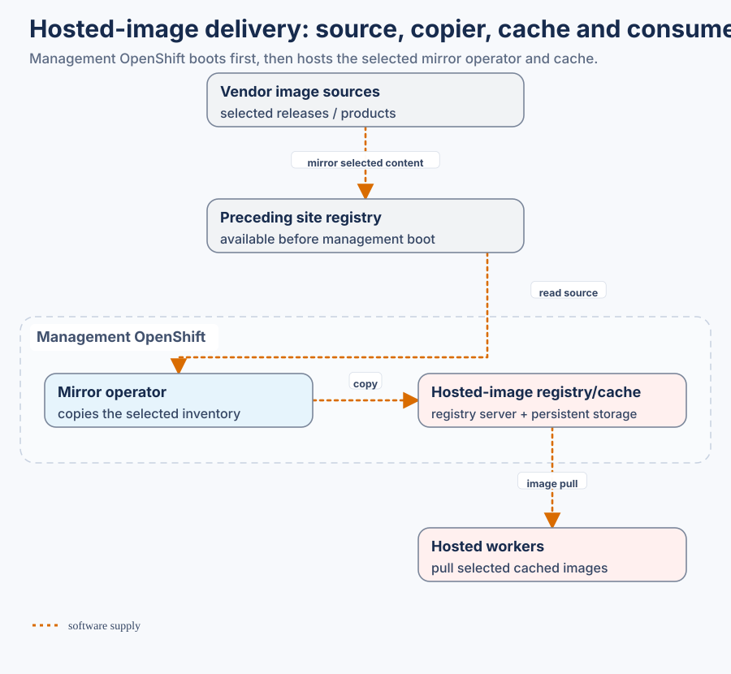

# Image-delivery architecture

This detailed view answers who supplies images, who hosts the registry, and which consumers can start at each stage.

The shared architecture is maintained in [Datacenter: external sources, site registry and hosted cache](https://github.com/mahowlin/secure-ai-datacenter/blob/main/docs/architectures/REGISTRY_CHAIN.md). It defines the bootstrap order and the owner at each handoff.

This repository owns external service execution and the **external → site registry** producer:

- [Select image inventories and generate mirror policies](mop/01-image-mirroring.md).
- [Configure an optional runner/registry host](mop/03-runner-vm.md).
- [Pass shared values through the project contract](PROJECT_INPUTS.md).
- [Maintain hosted-cache trust and credentials](mop/06-hcp-local-registry-trust.md).

The optional `sync-hcp-oc-mirror-operator.yaml` workflow consumes the non-secret contract exported from Datacenter. It mirrors the selected pinned operator images into the preceding site registry. It does not populate the hosted cache or qualify operator recovery. See [the pinned operator/export reference](https://github.com/mahowlin/secure-ai-datacenter/blob/main/docs/architectures/MIRROR_OPERATOR.md) for exact inputs and activation prerequisites.

## Selected hosted-cache production

Use the [versioned inventory and lifecycle procedure](https://github.com/mahowlin/secure-ai-datacenter/blob/main/docs/architectures/HCP_CACHE_LIFECYCLE.md). Datacenter exports the same selected roots and destination map consumed by `scripts/hcp-cache-images.py`, existing `Sync Images` target `hcp-cache`, and the existing bundle promoter's `hcp-cache` scope. Source production writes only the preceding registry; the optional operator owns cache copies. Read-only reader verification is separate and never copies. All new operations retain normal TLS, explicit public-CA selection and separate private reader/writer custody.

The producer expects an exported non-secret contract staged at `hcp_cache_contract`; the Linux x86_64 runner job stages checksum-verified crane0.22.0 temporarily, using the existing bootstrap mechanism. A site supplies the complete versioned release/architecture/disk/product/add-on inventory, resolves unknown dependencies and refreshes it before release changes. No frozen lab BOM is shipped. Source promotion is not sufficient to activate a hosted consumer: the current reader-side result is checked by Datacenter's lifecycle render boundary.
